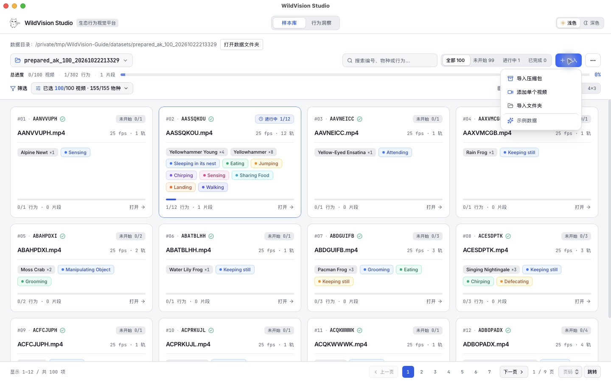
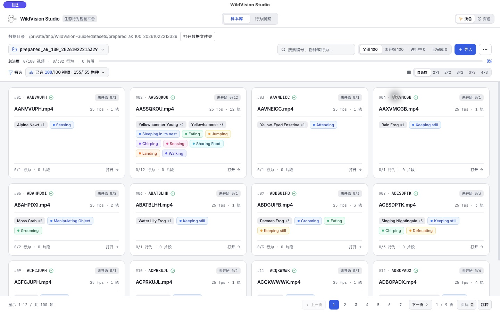
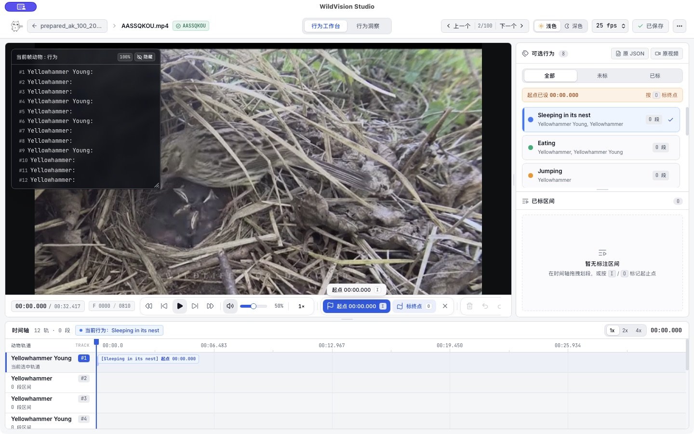
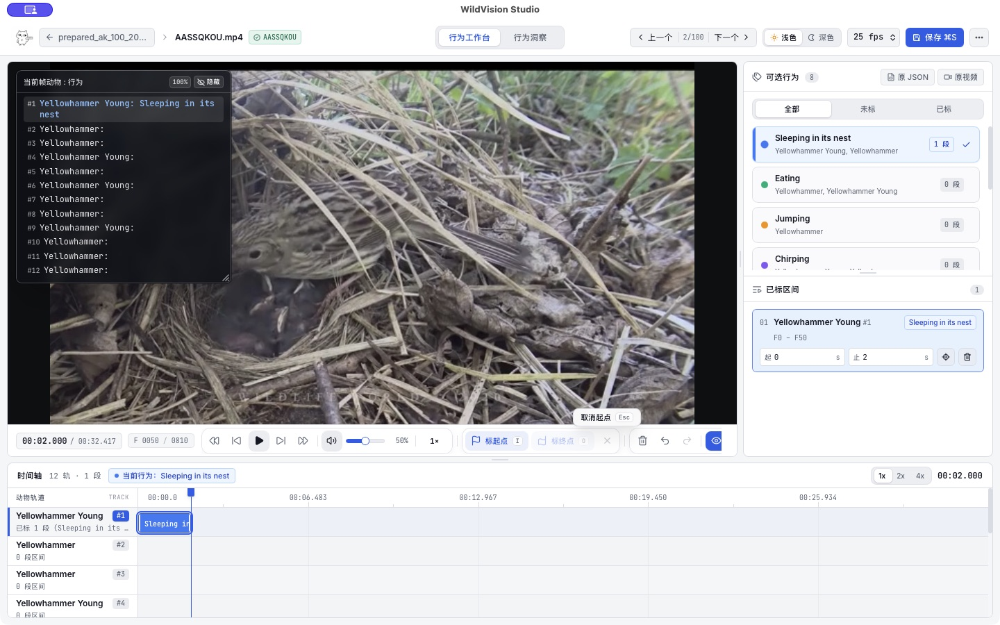
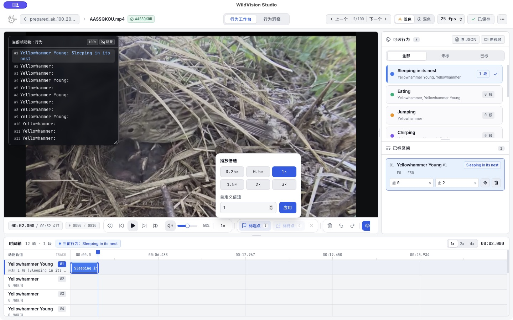
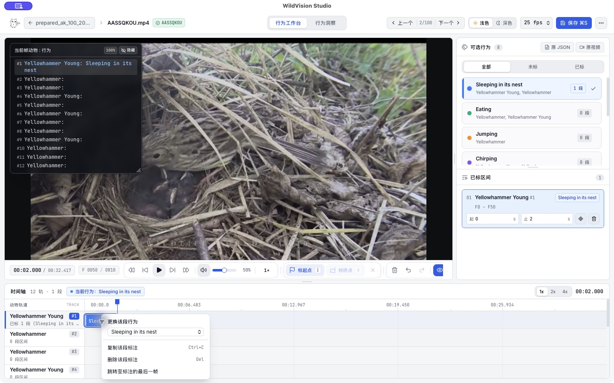
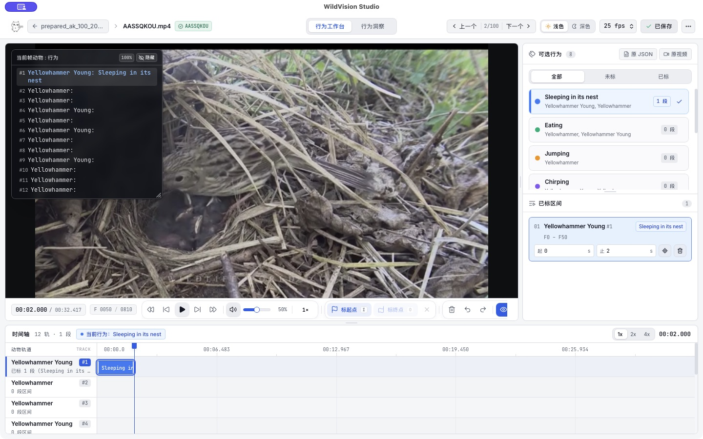
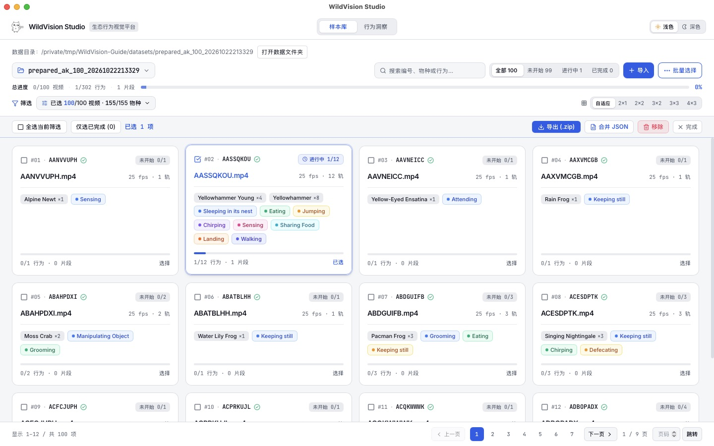

# WildVision

[简体中文](README.md) | **English**

WildVision is a desktop tool for annotating animal behavior in videos. Select an animal and a behavior, mark the start and end times, then save and export your annotations.

## Download and open

Go to [Releases](https://github.com/AImiHoYo/WildVision/releases), download the ZIP for your computer, and **extract the entire ZIP before opening the app**:

- **Mac with Apple silicon (M series)**: choose the ZIP with `macOS-arm64` in its name, then double-click `WildVision.app` inside the extracted folder.
- **64-bit Windows on Intel / AMD**: choose the ZIP with `Windows-x64` in its name, then double-click `WildVision.exe` inside the extracted folder.

You do not need to install Python or FFmpeg or set up a development environment. If Windows asks you to install WebView2 on first launch, follow the prompt. The `Source code` downloads at the bottom of the release page are for developers; use the desktop ZIP to run the app. An Intel Mac package is not currently available. The `.sha256` file next to each ZIP lets you check the download's integrity.

Keep the whole extracted folder in a writable location, such as Documents or your personal work folder. The `datasets` folder beside the app holds imported videos and annotations. Keep it together with the app rather than moving the `.app` or `.exe` on its own.

### If the app asks you to choose its folder

Click “选择软件文件夹” (Choose software folder) and select **the entire WildVision folder you just extracted**. Opening that folder should show `WildVision.app` or `WildVision.exe` directly inside it.

This step tells the app where to store its data. **Do not select a dataset ZIP, the `datasets` subfolder, or a folder inside the app bundle**. Once confirmed, the sample library opens, where you can import your dataset. A wrong selection shows a red explanation; click “重新选择软件文件夹” (Choose software folder again) to retry. You do not need to move the app or open a terminal.

The app remembers this location by default. If the folder is moved, becomes unwritable, or the remembered location is no longer valid, you will be asked to select it again. Existing data is not moved or deleted automatically.

### If macOS says Apple cannot verify the app

The macOS package uses an ad-hoc signature. It does not have an Apple Developer ID signature or notarization. On first launch, you may see this warning:


After checking that your ZIP came from this repository:

1. Click “Done” in the warning and keep `WildVision.app`.
2. Open **System Settings → Privacy & Security**. Scroll to the Security section and find the message about WildVision being blocked.
3. Click **Open Anyway**, authenticate when asked, then confirm **Open** in the next dialog.
4. Open WildVision from the folder you kept. Keep the `.app` together with the rest of that folder.

If “Open Anyway” has not appeared, try opening WildVision once more, then return to Privacy & Security. See [Apple's instructions](https://support.apple.com/102445).

## Annotate a video, step by step

These screenshots were taken while operating **WildVision v1.1.3 on macOS**, using `AASSQKOU.mp4` from the `prepared_ak_100.zip` dataset. The 0–2 second interval illustrates the controls; it is not reviewed behavior ground truth. Windows users can follow the same button labels.

The screenshots show the Chinese interface. The instructions below include the labels you will see on screen, with English explanations.

### 1. Import a prepared dataset

In the top right of the sample library, click “导入 → 导入压缩包” (Import → Import ZIP), then select the dataset ZIP you received. For a dataset that is already extracted, choose “导入文件夹” (Import folder).



Wait for the import to finish. Each video appears as a card. This example contains 100 videos. Find `AASSQKOU.mp4` and click “打开” (Open) at the bottom right of its card. You can also search for a video ID using the search box at the top.



If someone has prepared the dataset for you, import it directly. It needs to include videos and JSON files that list the animals and available behaviors. If you are preparing the data yourself, see [Dataset format](#dataset-format) below. To practice without a dataset, choose “导入 → 示例数据” (Import → Sample data); the built-in video uses a test pattern.

### 2. Select a behavior and a track, then mark the start

Watch the video first to identify the subject and behavior you want to annotate. Click a behavior under “可选行为” (Available behaviors) on the right, then click the corresponding animal track in the timeline below. **A track is a row where annotations are placed**. Follow the animals and numbers supplied with your dataset.

In this example, select `Sleeping in its nest` and the `Yellowhammer Young #1` track. Pause at the start of the behavior and click “标起点” (Mark start) in the playback bar, or press `I`. The button changes to “起点 00:00.000”, showing that the start has been recorded. There is no complete interval yet.



The app does not identify or track animals automatically. Keep the subject numbering and annotation meaning consistent yourself.

### 3. Move to the end and mark it

Play the video or move the playhead to the end of the behavior. Click “标终点” (Mark end), or press `O`. Here, stopping at 2 seconds creates a blue 0–2 second bar in the timeline and a matching record under “已标区间” (Annotated intervals) on the right.



Use the previous-frame and next-frame controls to adjust your position precisely. If you marked the wrong start, press `Esc` to cancel it and start again. Continue marking further intervals, selecting a different track first whenever needed.

**Slow down playback for a closer look.** Click `1×` beside the volume control in the playback bar. Choose `0.25×`, `0.5×`, `1×`, `1.5×`, `2×`, or `3×`, or enter a custom speed and click “应用” (Apply). The speed is kept when you switch videos. Annotation times always refer to the original video time.



The `1x / 2x / 4x` buttons at the top right of the timeline control **timeline zoom**, separately from playback speed. The lowercase `x` matches those buttons on screen.

### 4. Review and edit annotations

Select a timeline bar and check its behavior, track, and start and end times against the record on the right.

- **Adjust the times**: edit “起” (Start) and “止” (End) on the right, or drag either end of the bar.
- **Change the behavior**: right-click the bar and choose the correct behavior from the dropdown under “更换该段行为” (Change this interval's behavior).
- **Remove an interval**: select it and delete it. Use the undo button in the playback bar to recover an accidental deletion or edit.



Changing the behavior keeps the interval's track and times. Even if several intervals are selected, only the one you right-clicked is changed. If it would touch or overlap an existing interval of the same behavior on the same track, the app asks you to adjust the interval first.

### 5. Save and move to another video

Click “保存” (Save) in the top right and wait for it to show “已保存” (Saved). In this example, the saved 0–2 second interval is still visible on the right.



Click “下一个” (Next) at the top to continue, or “上一个” (Previous) to go back. The app saves your current changes before switching. If saving fails, or you have a start point without an end, it stays on the current video and asks you to resolve the issue.

Open the same dataset next time to continue editing your saved work. **Saving writes to the local `datasets` folder; it does not update the ZIP you originally imported.** Export your results when you need to share them.

### 6. Export your results

Click the dataset name in the top left to return to the sample library. Click “…” in the top right to enter “批量选择与导出” (Batch selection and export). Select the video cards you want to deliver, check the selected count, then click “导出 (.zip)” (Export ZIP) and choose where to save it.



The ZIP contains each video's annotation at `annotations/<video_id>.json`, plus the files below. **It does not include the original videos.**

- `merged_annotations.json`: combined annotations for the selected videos.
- `ak_action_recognition.csv`: an action recognition CSV list.
- `mmaction2_annotations.txt` and `ak_vg_grounding.txt`: TXT lists for MMAction2 and temporal behavior grounding.

You can also click “合并 JSON” (Merge JSON) directly. In this example, the exported `annotations/AASSQKOU.json` retains the 0–2 second interval.

The card still shows “进行中 1/12” (In progress, 1/12), because this walkthrough demonstrates only one annotation item. A successful save does not mean the whole video has been fully annotated. Check all required items before handing over your work.

To save a separate JSON for just the current video, use “另存为…” (Save as…) in the annotation view's top-right “…” menu. Include the dataset name and date in your export filename, and keep an extra backup.

## Keyboard shortcuts

| Action | Shortcut |
| --- | --- |
| Play / pause | Space |
| Mark start / end | `I` / `O` |
| Cancel an unfinished start point | `Esc` |
| Previous / next frame | `←` / `→` |
| Save | Windows `Ctrl+S`; Mac `⌘S` |
| Undo | Windows `Ctrl+Z`; Mac `⌘Z` |
| Redo | Windows `Ctrl+Shift+Z`; Mac `⌘⇧Z` |

Shortcuts give way to text and numeric fields while you are editing them.

## Find and back up your data

The sample library shows the current data directory at the top. Click “打开数据文件夹” (Open data folder) to view it. Importing copies your data into `datasets` beside the app, with a separate folder for each dataset:

```text
WildVision-v1.1.4-your-system-and-architecture/
├── WildVision.app or WildVision.exe
├── datasets/
│   └── your-dataset/
│       ├── videos/         ← imported videos
│       └── annotations/    ← saved annotation JSON files
├── runtime/                ← autosaves and startup logs
├── core/, desktop/, ui/    ← bundled source code
└── README.md
```

**Copy the whole software folder when making a backup or moving to another computer.** To upgrade, extract the new version into a different folder, then copy your old `datasets` and `runtime` into it. Do not overwrite your existing data with the empty folders from a new package. Keep the original dataset ZIP and exported results separately as well.

<details>
<summary>Migrate data from v1.1.1 or earlier</summary>

Quit the old version. On Mac, press `⌘⇧G` in Finder and enter `~/.wildvision/datasets`. On Windows, enter `%USERPROFILE%\.wildvision\datasets` in the File Explorer address bar. Copy the dataset folders from there into the new version's `datasets`, keeping the old files.

If you have changes that were autosaved but not explicitly saved, open the old version and save them before copying. The new version will not move or delete old data automatically.

</details>

## Dataset format

A prepared dataset usually has two folders, with matching video and JSON filenames:

```text
my-dataset/
├── videos/
│   ├── video01.mp4
│   └── video02.mp4
└── annotations/
    ├── video01.json
    └── video02.json
```

The JSON files need to list the animals and available behaviors in advance. See the [data format guide](doc/data_specs/14_AK_Preprocessed_JSON_Schema_and_Guide.md) for fields and examples (in Chinese). Import the folder directly, or compress it into a ZIP first.

For a single video, choose “导入 → 添加单个视频” (Import → Add single video), then choose “载入预处理 JSON” (Load preprocessed JSON) from the annotation view's top-right “…” menu.

## Current limitations

Start with a small batch and keep exported copies of important annotations. The model demo in “行为洞察” (Behavior insights) uses cached example results; it does not indicate that a real model has run. Beginner installation checks, video audio across different systems, and third-party distribution materials still need further work. See the [release status](doc/release/Release_Readiness_Status.md), [v1.1.1 playback speed validation](doc/release/Playback_Speed_Validation.md), and [annotation workflow validation](doc/release/Annotation_Workflow_Validation.md) for details (in Chinese).

Report problems in [Issues](https://github.com/AImiHoYo/WildVision/issues), including the app version, operating system, and steps to reproduce them. Use examples you can share publicly, and keep private videos or data you do not have permission to share out of the report.

## Development and license

The project code is licensed under [GPL v3 (GPL-3.0-only)](LICENSE). Third-party libraries, fonts, and assets retain their own licenses; see [third-party notices](THIRD_PARTY_NOTICES.md).

The frontend is in `ui/`, desktop interfaces are in `desktop/`, and annotation and data processing code is in `core/`. To build the app yourself, see the [build and packaging instructions](doc/release/ZIP_Release_Procedure.md). More documentation is listed in the [documentation index](doc/README.md). These guides are in Chinese. You do not need a development environment to use the desktop app.
