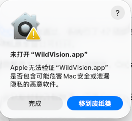

# WildVision

WildVision 是一个给动物视频做行为标注的桌面工具。你可以在视频里找到某只动物的一段行为，记下开始和结束时间，再把结果保存成 JSON。同一段视频里有多只动物时，每只动物各占一条时间线。

## 下载和打开

到 [Releases](https://github.com/AImiHoYo/WildVision/releases) 下载与你电脑对应的 **ZIP 附件**，完整解压后再打开：

| 电脑 | 文件名中的标记 | 打开方式 |
| --- | --- | --- |
| Apple 芯片的 Mac（M 系列） | `macOS-arm64` | 保留整个解压文件夹，双击其中的 `WildVision.app` |
| Intel / AMD 64 位 Windows | `Windows-x64` | 双击解压目录里的 `WildVision.exe` |

当前提供 macOS arm64 和 Windows x64；Intel Mac 暂无安装包。每个 ZIP 都附有同名 `.sha256` 校验文件。

桌面包已包含 Python、前端资源和 FFmpeg，Windows 包还附带首次启动时使用的 WebView2 离线安装组件。`Source code` 是供开发者使用的源码，不是安装包。当前为预发布版本，双平台首次运行、实际声音和最低系统版本尚未完成验收。

### 数据保存在什么地方

从 v1.1.2 起，桌面 ZIP 使用便携目录：程序、源码和数据放在同一个文件夹中。无需运行源码或配置开发环境，直接双击程序即可。

```text
WildVision-v1.1.2-你的系统与架构/
├── WildVision.app 或 WildVision.exe
├── datasets/       ← 导入的视频、标注和数据集索引
├── runtime/        ← 自动保存与启动日志
├── core/           ← 源码
├── desktop/
├── ui/
├── assets/
└── README.md
```

导入后，每个数据集在 `datasets` 中占一个子文件夹，里面的 `videos` 存视频，`annotations` 存标注 JSON。样本库会显示当前数据目录，点“打开数据文件夹”可以直接查看。

请把整个文件夹放在你有写入权限的位置，例如“文稿”或个人工作目录；搬家、备份时也复制整个文件夹。升级时先解压到新文件夹，再把旧版的 `datasets` 和 `runtime` 复制过去，不要用新包的空目录覆盖已有数据。

**从 v1.1.1 或更早版本升级：**退出旧版，在 Finder 按 `⌘⇧G`，输入 `~/.wildvision/datasets`；Windows 可在资源管理器地址栏输入 `%USERPROFILE%\.wildvision\datasets`。将其中的数据集文件夹复制到新版的 `datasets`。旧文件保留不动；恢复旧版自动保存的未保存修改，请先在旧版保存后再复制。新版不会自动搬走或删除旧数据。

Mac 若提示正在临时隔离路径中运行，请退出，用 Finder 把 `WildVision.app` 暂时移到便携文件夹外，再移回与 `datasets` 同级的位置后重开。不要在 `.app` 包内部存数据，也不要只把 `.app` 拖进“应用程序”。这与首次打开时的“隐私与安全性”确认是两件事。[Apple 的路径随机化说明](https://developer.apple.com/forums/thread/724969)。

### Mac 首次打开提示“Apple 无法验证”

macOS 版采用本地自签名（ad-hoc），没有 Apple Developer ID 签名与公证。第一次打开时，可能出现下面的提示：



确认 ZIP 来自本仓库后，按下面的步骤打开：

1. 在这个弹窗中点“完成”，保留 `WildVision.app`。
2. 打开“系统设置 → 隐私与安全性”，向下找到“安全性”区域中刚刚阻止 WildVision 的提示。
3. 点“仍要打开”，按系统要求验证身份，并在后续弹窗中确认“打开”。
4. 之后从保留的便携文件夹中打开 WildVision，不要单独移动 `.app`。

如果还没有出现“仍要打开”，先再尝试打开一次 WildVision，再回到“隐私与安全性”查看。[Apple 官方操作说明](https://support.apple.com/zh-cn/102445)。

## 完整标注一段视频

### 1. 导入数据

打开软件后进入“样本库”。点击“导入”，选择“导入压缩包”或“导入文件夹”，载入准备好的视频和标签文件。导入完成后，每段视频会显示为一张卡片，点击卡片的“打开”进入标注界面。

第一次使用，可以先点“示例数据”熟悉操作。安装包里的示例视频是测试图案和音调，只用于试用，不是真实动物素材。

数据集通常长这样，视频与 JSON 使用相同的文件名：

```text
我的数据集/
├── videos/
│   ├── video01.mp4
│   └── video02.mp4
└── annotations/
    ├── video01.json
    └── video02.json
```

JSON 里需要提前写好动物清单和可选行为。标注员拿到准备好的数据集后直接导入即可；准备数据的人可以参考 [数据格式说明](doc/data_specs/14_AK_Preprocessed_JSON_Schema_and_Guide.md)。只有视频、没有标签时，也可以先“添加单个视频”，再从右上角“…”选择“载入预处理 JSON”。

### 2. 选中要标的动物和行为

先看一遍视频，确认这一段是谁在做什么。在右侧“可选行为”中点击一个行为，再点击下方时间线对应的动物轨道。

例如，要标第二只鸟的进食行为，就先选 `Eating`，再选这只鸟对应的 `#2` 轨道。同一种动物有多个个体时，要在整段视频里保持编号一致；软件不会自动替你识别或跟踪个体。

### 3. 标出开始和结束

把视频停在行为开始的位置，点击“标起点”；播放或拖动到行为结束的位置，再点击“标终点”。时间线上会出现一条有颜色的标注，右侧“已标区间”也会列出它。

播放栏的倍速按钮默认显示 `1×`。点开后可以选择 `0.25×`、`0.5×`、`1×`、`1.5×`、`2×`、`3×`，也可以输入自定义倍速，再点“应用”。切换视频会保留所选倍速；标注时间仍按原视频时间记录。

起止位置拿不准时，用播放栏的上一帧、下一帧微调。标错了起点，点击取消起点后重新标即可。完成一段后继续标下一段；另一只动物的行为则切到它的轨道再标。

### 4. 检查和修改

点选已标区间，检查它的动物、行为和时间是否正确。

- **时间不准**：修改右侧的起止时间，或选中时间条后拖动两端。
- **行为选错**：右键点击时间条，在“更换该段行为”里重新选择。动物、轨道和时间不变，多选时也只修改右键点击的这一段。
- **整段不要了**：选中后删除。误删或改错可以用播放栏的撤销、重做按钮恢复。

更换行为时，如果它会与同轨道已有的同类行为相接或重叠，软件会提示先调整区间，保留现有标注。

### 5. 保存，继续下一个视频

点右上角“保存”，等按钮显示“已保存”。也可以直接点顶部的“下一个”：软件会先保存当前修改，成功后再切换。“上一个”可以回看前一段视频。

如果保存失败，或还留着没有结束的起点，软件会停在当前视频并提示原因。先处理提示，再继续。到数据集的第一个或最后一个视频时，对应方向的按钮会变灰。

下次打开软件后，从样本库进入同一数据集，可以继续编辑已保存的标注。导入的数据在本机工作区中保存，原始导入 ZIP 不会随标注一起更新；要把结果交给别人，请执行下一步导出。

### 6. 导出结果

全部检查好后，点击左上角的数据集名称返回样本库，进入“批量选择与导出”，勾选需要交付的视频卡片，再点“导出 (.zip)”。这个 ZIP 包含标注和配套清单，不包含原始视频。也可以导出合并 JSON，方便后续处理。

只想另存当前视频的标注，可用右上角“…”里的“另存为…”。建议把导出文件放到单独的结果目录，并注明数据集名称和标注日期。

## 常用快捷键

| 操作 | 按键 |
| --- | --- |
| 播放 / 暂停 | 空格 |
| 标起点 / 标终点 | `I` / `O` |
| 取消未完成的起点 | `Esc` |
| 上一帧 / 下一帧 | `←` / `→` |
| 保存 | Windows `Ctrl+S`；Mac `⌘S` |
| 撤销 | Windows `Ctrl+Z`；Mac `⌘Z` |
| 重做 | Windows `Ctrl+Shift+Z`；Mac `⌘Shift+Z` |

输入文字或修改时间数值时，快捷键会让位给输入框。

## 使用前了解这些限制

当前版本适合先用小批数据试用，重要标注请保留导出副本。“行为洞察”中的模型演示使用缓存示例结果，不代表运行了真实模型。新手安装、不同系统的视频声音，以及第三方组件分发材料还有待补齐；具体记录见 [发布状态](doc/release/Release_Readiness_Status.md)、[v1.1.1 倍速验证](doc/release/Playback_Speed_Validation.md) 和 [标注工作流验证](doc/release/Annotation_Workflow_Validation.md)。

遇到问题可在 [Issues](https://github.com/AImiHoYo/WildVision/issues) 留下软件版本、系统和复现步骤。请使用可公开的示例，不要上传私人视频或未经许可的数据。

## 开发与许可证

项目代码采用 [GPL v3（GPL-3.0-only）](LICENSE)。第三方库、字体和素材保留各自的许可证，见 [第三方说明](THIRD_PARTY_NOTICES.md)。

前端位于 `ui/`，桌面接口位于 `desktop/`，标注与数据处理代码位于 `core/`。自行构建请看 [构建和打包步骤](doc/release/ZIP_Release_Procedure.md)；更多文档见 [文档目录](doc/README.md)。普通标注用户不需要配置开发环境。
